# FileBird

**An SSH and SFTP client in one window.** Your Mac on the left, your server on the
right. Drag files between them, and run commands on the same connection without
opening another app.

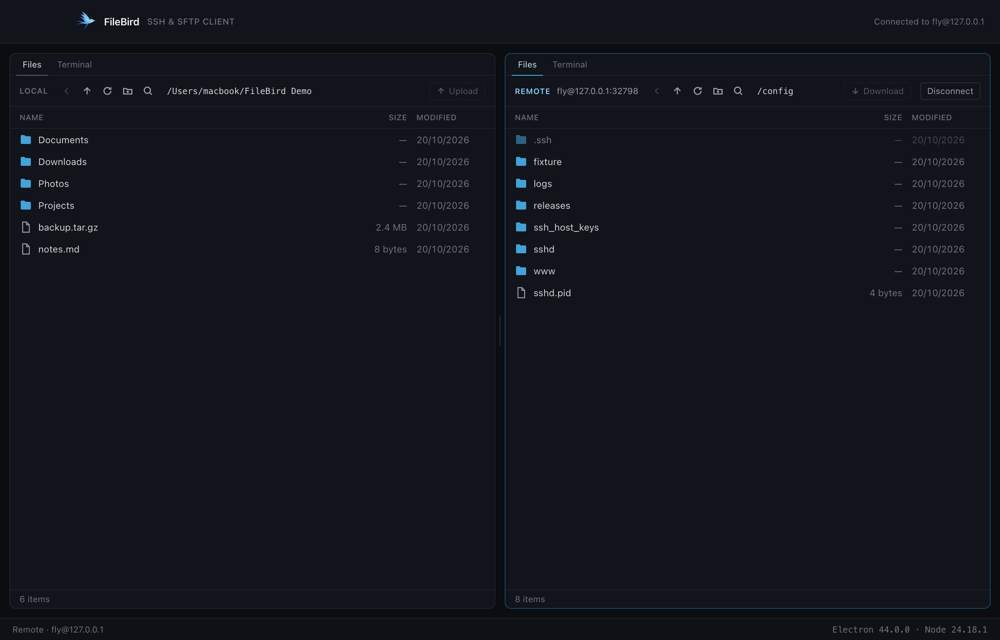

FileBird is a desktop app for anyone who keeps files on a server: developers
deploying a site, teams moving backups, anyone who has ever juggled an FTP client
in one window and a terminal in another. It does both jobs at once, over the
single SSH connection you have already made.

---

## What it does

| | |
|---|---|
| **Two panes, side by side** | Your computer and your server at the same time, each with its own history, selection and search. |
| **Transfers that behave** | Drag files across, or press a button. A queue moves them three at a time, with progress, speed, cancel and retry — and never leaves a half-written file behind. |
| **Real terminals** | A shell on the server over the connection you are already using — no second login, no second password — and shells on your own machine. Split them side by side or stacked. |
| **Safe by default** | Passwords go to your system keychain, never to a file. Every server's identity is checked on every connection. Deletes on your own machine go to the Trash. |
| **Nothing phones home** | No accounts, no telemetry, no update pings. |

---

## Installing

### macOS

FileBird needs macOS 13 (Ventura) or later.

1. Open `FileBird-<version>-mac-x64.dmg` (Intel) or `-arm64.dmg` (Apple Silicon)
   and drag **FileBird** onto **Applications**.
2. Open FileBird. The first time, macOS says it cannot verify the developer:
   click **Done**.
3. Go to **System Settings → Privacy & Security**, scroll to **Security**, and
   click **Open Anyway** next to FileBird. You only do this once.

That warning appears because these builds are not yet signed with a paid Apple
developer certificate. Nothing is wrong with the app; macOS simply cannot tell
who built it.

### Windows

Run `FileBird-<version>-win-x64-setup.exe`. SmartScreen warns about an
unrecognised app: choose **More info → Run anyway**. Passwords are stored in
Windows Credential Manager.

### Linux

```bash
chmod +x FileBird-<version>-linux-x86_64.AppImage
./FileBird-<version>-linux-x86_64.AppImage
```

Saving passwords needs a Secret Service provider (GNOME Keyring or KWallet), and
AppImages need FUSE (`libfuse2` on Ubuntu 22.04 and newer).

> The Windows and Linux builds are produced on a Mac and have not yet been run on
> those systems. The macOS build is the one in daily use.

---

## A guided tour

### 1. Opening FileBird

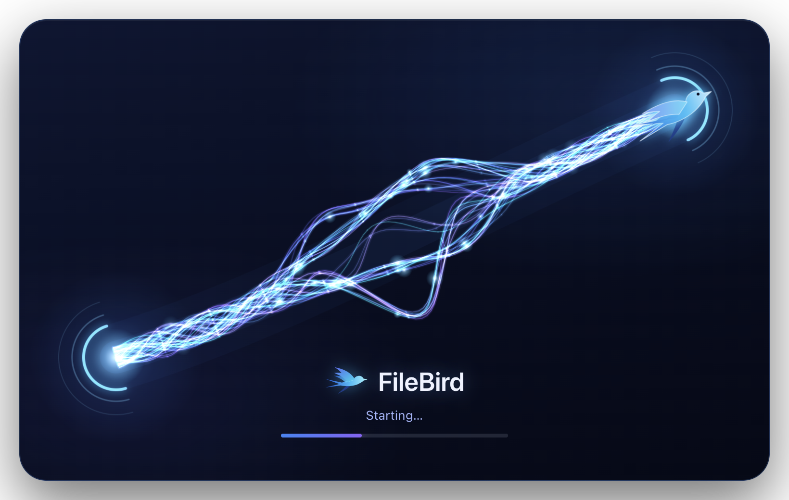

A short animation while the app starts, then the main window.

### 2. Your servers

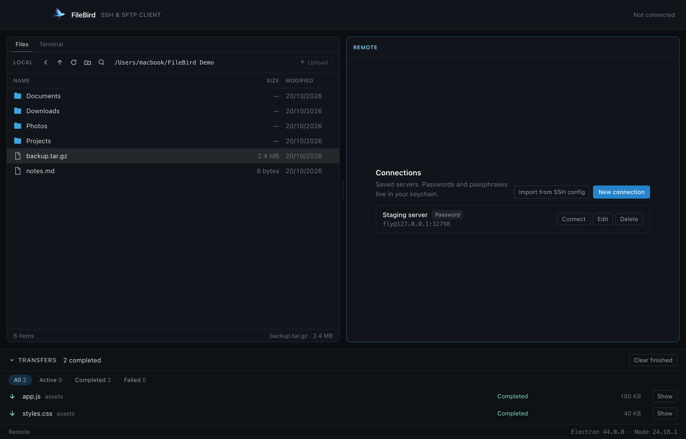

The right-hand pane lists every server you have saved, with how you sign in to
each and whether its password is already in your keychain. **Connect** opens it,
and each row also offers **Edit**, **Delete** and **Forget password** (or
**Forget passphrase**, for a key). **New connection** adds one by hand.

If you already use `ssh` from a terminal, **Import from SSH config** reads your
`~/.ssh/config` and lists the hosts it finds, so you can tick the ones you want
rather than typing them again.

### 3. Adding a server

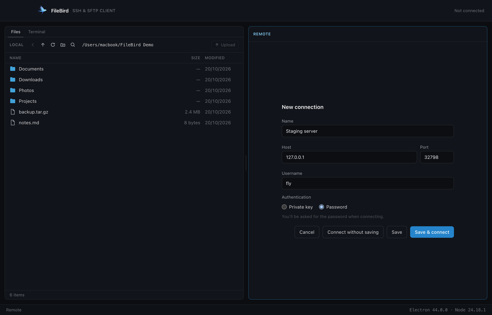

A name, a host, a port and a username, then either a **password** or a **private
key**. Choosing a key opens a file picker; FileBird reads the key only when you
connect, and tells you what it found — the type, its fingerprint, and whether it
needs a passphrase.

You can also use **Connect without saving** for a one-off server.

### 4. Signing in

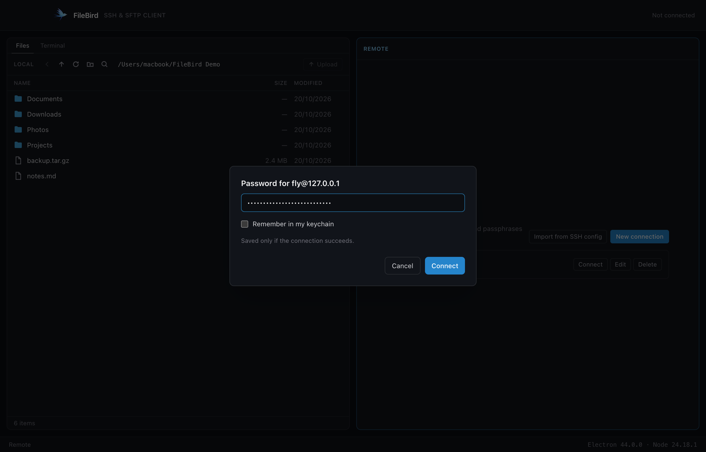

Passwords and passphrases are asked for when you connect, not stored in the form.
Tick **Remember** and it goes into your login keychain — but only *after* the
server has accepted it, so a typo never gets saved.

### 5. The first connection: checking the server

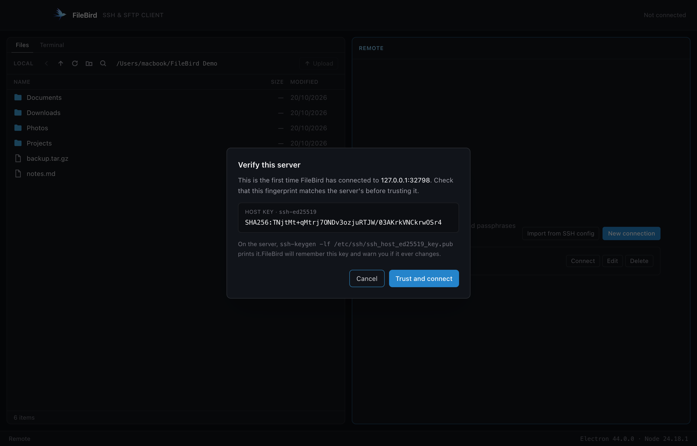

The first time you reach a server, FileBird shows you its fingerprint before
trusting anything, and refuses to continue until you confirm. From then on that
key is checked on every connection.

If a known server's key ever changes, FileBird stops and tells you. There is no
"connect anyway" button, because a changed key is exactly what a machine in the
middle of your connection would look like.

### 6. Two panes


Local on the left, the server on the right. The pane you last clicked is the
**active** one — it has a brighter border, and menu commands and shortcuts act on
it. `Cmd/Ctrl+1` and `Cmd/Ctrl+2` jump between them, and the divider in the
middle drags to give one side more room. FileBird remembers where you left it.

### 7. Browsing

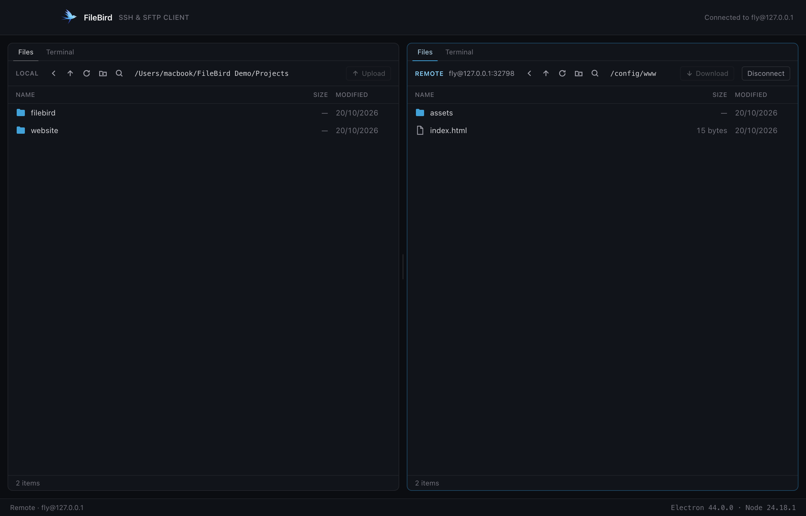

Click a folder to open it. Each pane has **Back**, **Parent folder**, **Refresh**,
**New folder** and **Search** in its toolbar, and the footer counts what is in
view and what you have selected.

- `Cmd`-click (`Ctrl` on Windows and Linux) adds to the selection; `Shift`-click
  extends it; `Cmd/Ctrl+A` selects everything.
- Hidden files are shown but dimmed. Links are marked, and a broken one is obvious.
- A folder that takes a moment to open says **Opening…** rather than looking stuck.

### 8. Copying files: drag and drop

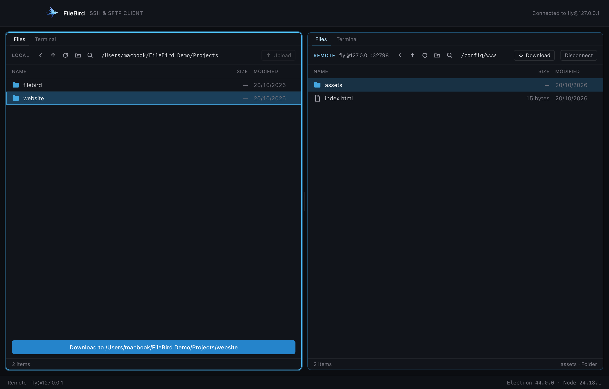

Drag a file or folder from one pane to the other. The label at the bottom names
exactly where it will land — drop it on a folder row to go inside that folder, or
anywhere else in the pane to use the folder on show.

Dragging within the *same* pane **moves** items into a folder instead. That is a
rename on the spot, so nothing is copied and nothing is overwritten.

Prefer buttons? Select what you want and press **Upload** or **Download**
(`Cmd/Ctrl+T`). A download you did not aim at a folder goes to your **Downloads**
folder, the way a browser would.

### 9. The transfer queue

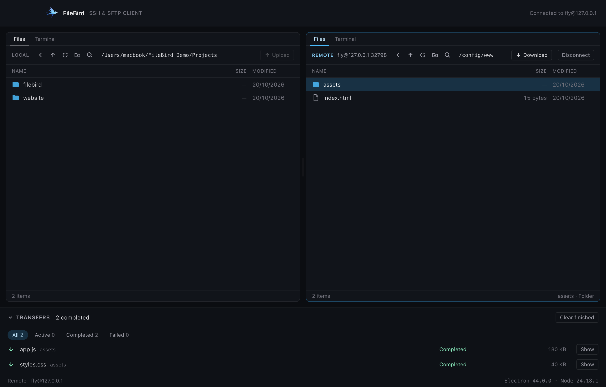

Every transfer joins a queue at the bottom of the window: three files move at a
time, each with its own progress and speed. You can **Cancel** one, **Retry**
a failed one — FileBird reconnects if the server dropped — and filter by
**Active**, **Completed** or **Failed**. **Show** opens a finished file in Finder
or File Explorer.

Two things happen quietly in the background and are worth knowing about:

- **Nothing is ever half-written under a real name.** Each file arrives under a
  hidden temporary name, is checked for size, then renamed into place. If the
  connection drops mid-transfer, you are left with the old file or no file —
  never a corrupt one.
- **Nothing is overwritten unless you say so.** If a name already exists you are
  asked once for the whole batch: **Replace**, **Keep both** or **Skip**. Replace
  merges folders rather than emptying them.

### 10. The terminal

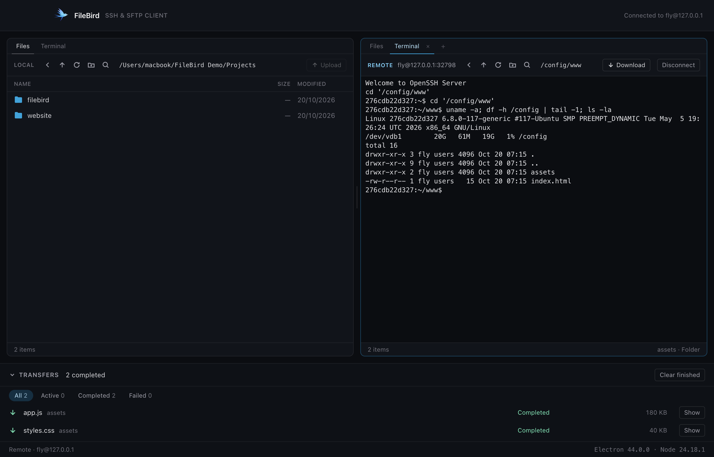

Each pane has a **Terminal** tab (`Cmd/Ctrl+\``). On the server side it opens a
shell over the connection you already have — no second login, no second password,
no second host-key question. On your own side it opens a shell on your machine.

It is a real terminal, so `sudo`, `vim`, `top` and anything else full-screen work
normally. It starts in the folder the pane is showing.

### 11. Splitting the terminal

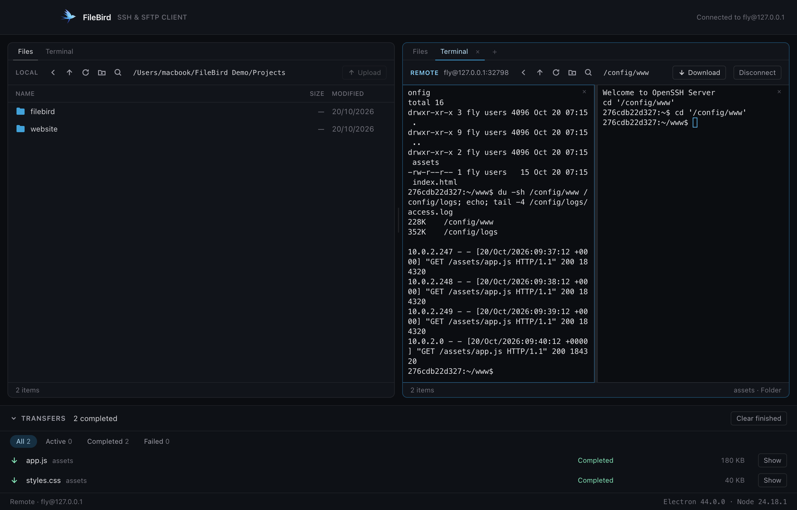

One shell is rarely enough — watch a log in one, work in another.

- **Split Vertically** (`Cmd/Ctrl+D`) puts two shells side by side.
- **Split Horizontally** (`Cmd/Ctrl+Shift+D`) puts one above the other.
- **Add Tab** (`Cmd/Ctrl+Shift+T`), or the **+** in the tab strip, starts another
  terminal tab.

Right-click inside any terminal for the same choices. Drag the divider to resize,
and **×** closes just that half. Splits can be split again, each one its own
shell with its own scrollback and its own starting folder.

A pane runs up to eight shells on your own machine and four on a server —
a server allows only so many channels on one connection, and FileBird leaves room
for your transfers.

### 12. Finding a file

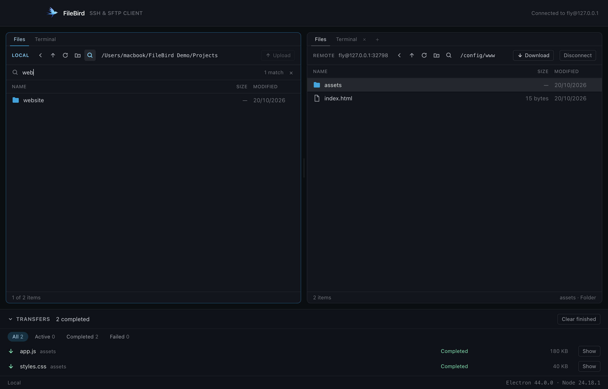

Press `Cmd/Ctrl+F` or click the magnifier and the list narrows as you type. The
footer keeps count ("3 of 128 items"). `Enter` hands the list back to the
keyboard with the first match selected, `Escape` clears it, and opening another
folder starts fresh — so nothing stays hidden by accident.

### 13. Making and renaming things

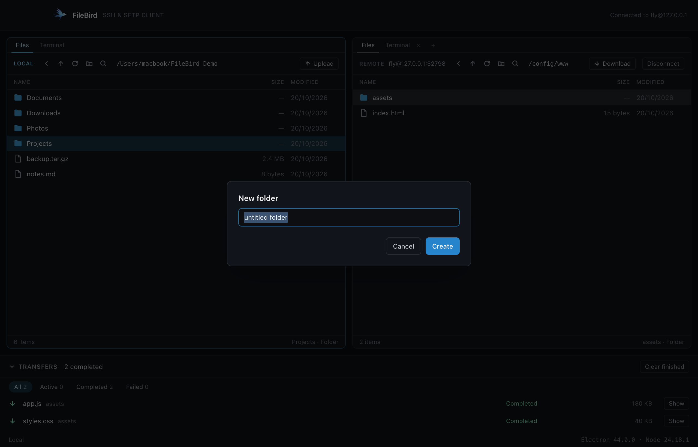

**New folder** sits in each pane's toolbar (`Cmd/Ctrl+Shift+N`), and `F2` renames
whatever is selected. Names are checked as you type against the rules of the side
you are on, so you find out before the server refuses. A rename never replaces
something that already exists.

### 14. Deleting safely

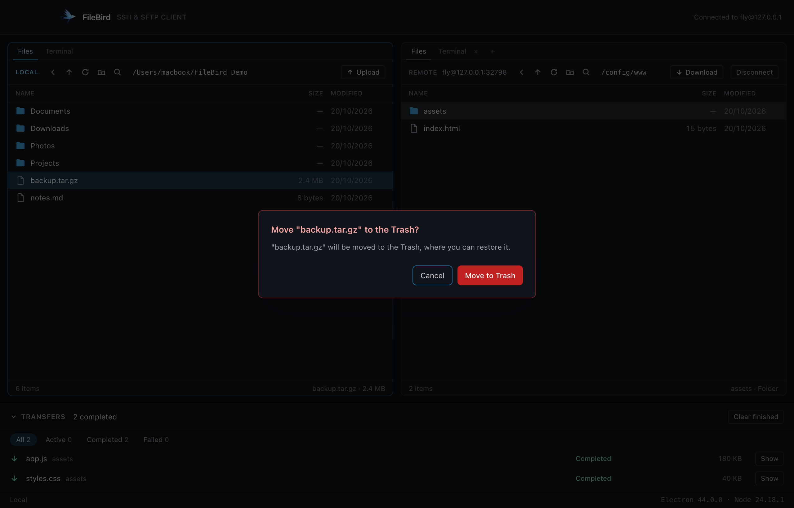

`Delete` (or `Cmd+Backspace` on a Mac) removes what is selected, after asking.

- **On your own machine**, items go to the **Trash**, where you can get them back.
  FileBird never deletes local files permanently.
- **On a server** there is no Trash, so deleting really is permanent — the
  question says so plainly, and folders are deleted with everything inside them.
  FileBird never follows a link when deleting, so removing a shortcut never
  touches what it points at.

Your home folder, the drive's root and any folder containing them are refused
outright, on either side.

---

## Everything FileBird does

**Connecting**
- Saved servers with password or private-key sign-in (`ed25519`, `rsa`, `ecdsa`).
- Passwords and passphrases in the OS keychain — Keychain on macOS, Credential
  Manager on Windows, Secret Service on Linux — saved only after they work.
- One-way import from `~/.ssh/config`, including `IdentityFile`. Hosts with
  settings FileBird cannot honour are listed with a warning instead of failing later.
- Server identities trusted on first use, after you have seen the fingerprint;
  a changed key is a hard stop.

**Files**
- Two independent panes, each with its own history, selection, search and zoom.
- Click to open, `Cmd`/`Shift`-click to select, right-click for a menu of what
  can be done with the selection.
- Hidden files shown and dimmed; links marked; broken links obvious.
- Per-folder search (`Cmd/Ctrl+F`) on both sides.
- Per-pane zoom from 75% to 200% (`Cmd/Ctrl+=`, `Cmd/Ctrl+-`, `Cmd/Ctrl+0`),
  remembered between runs — make one side bigger without touching the other.
- New folder, rename, delete, and move by dragging within a pane.

**Transfers**
- Files and whole folder trees, in both directions.
- A queue: three at a time, progress, speed, cancel, retry that reconnects.
- Conflicts asked once per batch: Replace, Keep both, Skip.
- Safe writes, so an interrupted transfer never leaves a half-file under the
  real name.
- Unaimed downloads land in your Downloads folder; drag to choose somewhere else.
- **Show** opens a finished file in Finder or File Explorer.
- Quitting with transfers running asks first.

**Terminals**
- A shell per pane, as tabs beside the files; up to eight locally, four per server.
- Split side by side or stacked, nested as deeply as you like, with draggable
  dividers.
- Remote shells run over the existing connection; local ones are real pseudo-
  terminals, so interactive and full-screen programs work.
- Output is throttled rather than allowed to flood the window, and nothing a
  terminal shows is ever written to a log.

---

## Keyboard shortcuts

| | |
|---|---|
| `Cmd/Ctrl+1` / `Cmd/Ctrl+2` | Focus the local / remote pane |
| `Cmd/Ctrl+R` | Refresh |
| `Cmd+[` / `Alt+Left` | Back |
| `Cmd+↑` / `Alt+Up` | Parent folder |
| `Cmd/Ctrl+T` | Transfer the selection to the other side |
| `Cmd/Ctrl+F` | Search this folder |
| `Cmd/Ctrl+A` | Select all |
| `Cmd/Ctrl+Shift+N` | New folder |
| `F2` | Rename |
| `Delete` / `Cmd+Backspace` | Delete |
| `Cmd/Ctrl+\`` | Switch between Files and Terminal |
| `Cmd/Ctrl+Shift+T` | Add a terminal tab |
| `Cmd/Ctrl+D` | Split the terminal vertically (side by side) |
| `Cmd/Ctrl+Shift+D` | Split the terminal horizontally (one above the other) |
| `Cmd/Ctrl+=` / `Cmd/Ctrl+-` / `Cmd/Ctrl+0` | Zoom this pane in / out / back to 100% |

---

## Your security and privacy

FileBird holds the keys to your servers, so it is built to deserve that.

- **Passwords and passphrases live only in your system keychain.** They never
  reach a settings file, a log, or the part of the app that draws the screen.
- **Private keys are read only at the moment you connect**, in the background
  part of the app. The interface only ever sees a summary: type, fingerprint,
  and whether a passphrase is needed.
- **Every server's identity is verified on every connection**, and a changed key
  stops the connection rather than warning you after the fact.
- **Terminal output is never logged**, at any level — a terminal routinely shows
  passwords, keys and whole environments.
- **The window that draws the interface has no access to your files, to the
  network, or to your system.** It asks the background part of the app for
  everything, one named request at a time, and every request is checked again on
  arrival.
- **Nothing is sent anywhere.** No accounts, no telemetry, no update pings. The
  app only ever talks to the servers you tell it to.

---

## Known limitations

- Builds are not signed with a paid developer certificate or notarised, so each
  operating system warns once on first open.
- Windows and Linux builds are made on a Mac and have not been run there yet.
- Moving files between two different disks on the same machine is refused (it
  would be a copy, not a rename) — transfer it through the other pane instead.
- Transfer history is kept in memory, so it is forgotten when the app closes.
- No SSH agent, `ProxyJump` or hardware keys yet, and `~/.ssh/known_hosts` is not
  read — FileBird keeps its own list of trusted servers.
- No searching inside a terminal's scrollback.

---

## For developers

FileBird is Electron, React and TypeScript. Everything that touches a disk, a
network or a shell happens in the main process; the window that draws the
interface asks for it through a small, hand-written bridge.

```bash
nvm use          # Node 24, pinned in .nvmrc
npm install
npm run dev      # Electron + Vite with hot reload
```

| Command | What it does |
|---|---|
| `npm run build` | Typecheck, then build main, preload and renderer |
| `npm test` | Unit tests (Vitest) |
| `npm run test:integration` | Against a real OpenSSH server in a container |
| `npm run smoke` | End-to-end checks driving the built app |
| `npm run verify:package` | Checks a packaged build, including launching it |
| `npm run screenshots` | Regenerates the pictures in this file |
| `npm run build:mac` | DMGs → `release/` (`build:win`, `build:linux` likewise) |

The integration, smoke and screenshot commands need Docker through Colima
(`colima start fly`).

- **SSH and SFTP:** `ssh2`, behind an interface so the app is not welded to one library.
- **Terminals:** `xterm.js` in the window; a real pty (`node-pty`) or an SSH shell
  channel behind it.
- **Tests:** 515 unit tests, 70 integration tests against a real OpenSSH server,
  159 end-to-end checks driving the built app, and 17 checks on the packaged app.

---

## Licence

MIT (see `package.json`).
